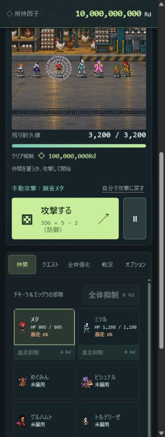

# v0.76.0 共有タイムラインへの移行・検証報告

基準は直前に導入済みの v0.75.1。v0.74.9の報酬調整とv0.75.1の実収益表示を維持したまま、自動行動の配分のみを新方式へ変更した。2026-10-11、Windows / Node.js v24.19.0で測定。

## 実装

- クエストごとに独立した `timeline.priorities` と累計獲得手番数 `timeline.turns` を持つ。既存の1秒境界を共通時計として、各クエストが最大1ユニットに手番を配分する。100msの進行呼出し、端数秒、最大8時間を維持。複数クエストが同じ秒に各1手ずつ進むことはある。
- Smooth Weighted Round Robin: 各重みを優先度へ加算→最大者を選択→合計重みを減算。同点はキャラ定義順、その後に敵ID昇順。行動値のダイス・支援・CP・暴走補正は既存の `actionPower()` 等を使用。ダイスは各秒の参加者について振る。
- `actionWeight()` を独立。正の行動値をそのまま使用し、上限1e100。不正値・負値は0。参加数は少数なので合計は浮動小数点の上限から十分遠い。動的な参加者・重み変更で古い信用／負債が残りすぎないよう、優先度は現在の合計重みの±2倍へ制限する（固定重みで通常のSWRRと同一）。
- スタンは抽選対象に残り、獲得した自身の手番で1減少。魔力チャージ、発射後5手番スタン、爆風障壁との競合は維持。
- ダウン・射程外・敵の攻撃準備中は対象外。ダウンや離脱時に優先度を削除し、復帰時0から参加。休憩中・全滅後の待機中は配分せず優先度を消去。待ち時間を手番として貯めない。
- Q変更は味方の優先度とスタンを保持し、入れ替わった敵の優先度を消す。部隊移動も旧戦場の優先度を持ち越さない。
- マックスは自分の1手を味方の1行動に置換。受け手への再譲渡や新しいタイムライン手番は作らない。受け手の攻撃に付随する再攻撃は従来の効果として同一手内で処理。
- 手動クリックは別枠。通常の非致死クリックでは優先度・獲得手番数を変更しない。手動で敵を倒したときの死亡・待機の整理は行う。
- 旧 `actionThreshold()`、個別AP蓄積／消費、AP残量からの大量自動行動、平均値での自動連打処理を削除。APゲージとCSSを削除。旧batch計算モジュールは回帰テスト資料として残るが、ゲーム／Workerから読み込まない。
- 行動値・理論手番率・次の8手の予測を表示。予測は期待行動値と現在の優先度をコピーして最大10回のSWRRを回すだけ。戦闘・ダイス・収益を模擬計算しない。将来の被弾、死亡、準備完了やダイスの変化までは予測しない。
- 理論DPSを手番配分へ接続し、上限付き追加攻撃の期待回数を使用。敵の準備状態・行動低下でキャッシュが更新される。実収益は引き続き実獲得因子から集計。

## AP関連能力の置換値

|効果|新しい処理|
|---|---|
|QUEEN’s BLESS・コグモのAP攻撃等|命中・防御／抵抗・強度による既存の威力計算後、低下率=min(50%, 威力÷(対象最大HP+威力))。5秒。HPを減らさない。再適用は強い低下率を維持し時間を更新。|
|ミツルの固定AP減少4|同じ換算を固定威力4で適用。高耐久相手では効果が小さくなる。|
|枠の割合AP減少|行動値−5%を5秒。繰り返し命中で割合を重ねない。|
|既存の行動値−4等|元の基礎行動値補正・5秒タイマーを維持。|
|クイーンの割込|命中時に攻撃を中止し、合計重みの50%→37.5%→25%→12.5%を敵優先度から減算。同じ敵へ4成功後は無効。下限は合計重みの−2倍。旧AP返還は廃止。|

低下率5秒は実時間。低速ユニットでは次の手番前に切れることもある。これらは新AP対応の設計値であり、敵HP・攻撃力・報酬の調整で補償していない。能力の説明も変更済み。

追加行動は1獲得手番に最大8行動、各行動の再攻撃は最大16回。自動攻撃は1獲得手番につき最大128攻撃処理（全体攻撃は各対象へ適用）。スタン時は1回だけ消費し、発射後スタンに入ったら残りの追加行動は終了する。

50%再行動は平均2回から1.9921875回（−0.390625%）。再攻撃30%なら平均回数の相対減少は0.3^16≒0.00000043%。譲渡は1回に固定するため、マックス自身を追加行動の対象としていた場合の譲渡期待回数は減る。手動攻撃の既存の再攻撃処理は維持した。

## 保存と時間

スキーマ52→53。旧APは味方・敵とも0へ移行し、タイムライン優先度は0から開始。旧予約攻撃の大量countは1へ正規化。既に開始した予約攻撃の残り時間・攻撃内容は引き継ぐ。新優先度はクエスト別に保存・検証。保存の互換フィールド `actionPoints` は0で残し、戦闘には参照しない。共通設定の旧閾値100は過去スキーマの移行計算にだけ残る。

放置復帰は既存Worker／継続ジェネレーターを使用。秒境界・RNG・予約攻撃・休憩を継続し、復帰中の二重処理防止と保存ロックも維持。

## 検証

- 全538テスト通過。旧APを前提にしていたテストは、新しい配分・移行・デバフ仕様へ改訂。新方式専用19テストを追加。
- 30:15:15の8,000手で4,000:2,000:2,000。参考実装の手順と各手ごとに一致。同点順も決定的。
- 支援ダイスがある予測・優先度減少計算も乱数を消費しない。比較ツールは未指定乱数を例外にし、8時間試行の600秒／3600秒時点の討伐数が短時間試行と一致することを確認。
- 1e100:1e98の10,100手で低速側100手、全優先度が有限。行動値を極端に上げても1秒1獲得手番。
- 同一手番に128攻撃が発生する極端乱数のケースで上限を確認。通常・スタン・魔力・マックス譲渡・精神攻撃・割込・敵の予告／召喚／蘇生・自動休憩・Q変更・複数戦場をテスト。
- 8時間・2クエスト・端数秒・スタン・休憩を含む同期実行と分割実行で、全状態と乱数消費回数が一致。各クエスト28,800手以下。
- 実ブラウザのWorkerで600.7秒・2クエストを実行し同期結果と完全一致。Worker完了を確認（フォールバックではない）。所要約236msは起動・転送込みの壁時計時間。
- 提供済みの2026-10-10 05:14／05:28の実セーブ2件も読込・再保存・再読込に成功。原本は変更せず、優先度は空・累計手番0へ移行。
- PC 1280×720、モバイル390×844で表示確認。理論順・行動値・配分率を確認し、ブラウザのエラーログ0件。ブラウザCPU・メモリの新旧比較は今回は測定していない。
- キャラクター定義は説明文・役割表記以外が一致。敵定義・強度設定は一致。全6クエスト×Q1,10,30,50,100,170,300,500の48能力／報酬プロファイルが旧版と一致。

## 比較条件

各試行は同じ初期状態、乱数シード74123、手動クリックなし、実時間ベースの放置進行。既存 `tests/boss-party-fixture.cjs` のLv/CP/パークを使用。めぐみん261（攻撃CP200/命中60）、枠232（攻撃100/行動100）、マックス244、ジュエル116、クイーン101。全員HP満タン、所持1e20Rd、安定化Lv18。部隊はこの5人、各行は別の独立試行。

死亡・暴走・回復も実行するため、10分→1時間→8時間で単純な比例にはならない。新旧では手番とRNG消費が変わり、同じシードでも同じ戦闘になることは期待しない。特に長時間の臨時収入は所持因子依存の複利で大きく振れる。以下はこの固定条件での実測例であり、全プレイヤーへの平均的な倍率ではない。

### 10分間の攻撃・ダメージ・収益

味方／敵攻撃数はイベント上の対象別攻撃回数（多段・全体攻撃を含み、空振りも含む）。実DPSは敵HPの実減少量÷600、被ダメージは味方HPの実減少量。行動低下はHPダメージへ合算しない。収益は討伐・オーバーキル・パーク等の総獲得で、支出は差し引かない。

|クエスト|討伐数 旧→新|味方攻撃 旧→新|敵攻撃 旧→新|実DPS 旧→新|被ダメージ 旧→新|Rd/秒 旧→新|収益変化|
|---|---:|---:|---:|---:|---:|---:|---:|
|モヒカン群れ（Q170）|89→58|482→304|477→226|2,515.18→1,671.57|414→187|2,769,501,993,387.98→1,797,968,264,500.35|-35.1%|
|旧き看守（Q170）|3→3|65→70|36→38|524.91→586.03|675→684|6,850,611,313,597.71→6,850,611,313,597.71|0.0%|
|オズモーン（Q170）|12→2|594→311|462→220|3,572.29→1,087.04|841→568|11,013,064,884,715.52→1,835,510,814,119.46|-83.3%|
|卵が先か鶏が先か（Q1）|75→68|269→274|0→0|750→680|0→0|217,187,500→196,916,666.67|-9.3%|

### キャラ別の自動行動処理回数（10分）

手番内の追加行動・スタン消費も含む `performAutomaticAction` 呼出し数。譲渡先の攻撃はマックスの1行動の中に含まれ、受け手の自動行動回数には足さない。新方式の純粋な獲得枠数は生データの `autoWinners` に別記。

|クエスト|めぐみん 旧→新|枠 旧→新|マックス 旧→新|ジュエル 旧→新|クイーン 旧→新|新方式の全体獲得手番|
|---|---:|---:|---:|---:|---:|---:|
|モヒカン群れ（Q170）|89→62|338→217|100→44|17→17|13→14|581|
|旧き看守（Q170）|6→6|49→57|11→9|0→0|3→3|123|
|オズモーン（Q170）|131→20|506→247|94→46|3→10|4→8|592|
|卵が先か鶏が先か（Q1）|33→55|263→218|5→44|0→10|0→1|329|

### Node処理時間

同一マシンで1試行ずつ。イベントを収集しない放置進行に、行動回数カウンターのみを計測用メモリ上で挿入した。ミリ秒。OS負荷・JITのばらつきを含み、保証値ではない。ゲーム側にこの計測処理は入らない。

|クエスト|10分 旧→新|1時間 旧→新|8時間 旧→新|8時間短縮率|
|---|---:|---:|---:|---:|
|モヒカン群れ（Q170）|1,184.53→391.67|1,685.7→1,223.57|7,167.83→4,718.04|34.2%|
|旧き看守（Q170）|159.14→99.55|430.9→327.78|2,783.27→2,172.62|21.9%|
|オズモーン（Q170）|1,062.35→392.45|1,147.74→1,047.88|3,621.13→3,456.41|4.5%|
|卵が先か鶏が先か（Q1）|637.42→280.9|2,795.01→1,757.27|15,856.93→12,565.97|20.8%|

### 長時間の討伐数と実収益

|クエスト|期間|討伐数 旧→新|Rd/秒 旧→新|新方式獲得手番|
|---|---|---:|---:|---:|
|モヒカン群れ（Q170）|1時間|89→242|461,583,665,564.79→1,262,783,558,868.26|3108|
|モヒカン群れ（Q170）|8時間|89→242|34,780,497,159,999.84→34,881,648,646,529.16|15508|
|旧き看守（Q170）|1時間|3→3|1,141,768,552,266.37→1,141,768,552,266.38|246|
|旧き看守（Q170）|8時間|6→6|35,009,091,570,979.18→285,442,138,066.67|1203|
|オズモーン（Q170）|1時間|12→7|1,835,510,814,119.33→1,070,714,641,569.68|1810|
|オズモーン（Q170）|8時間|12→20|229,438,851,765→382,398,086,274.96|5787|
|卵が先か鶏が先か（Q1）|1時間|147→76|70,947,916.96→36,294,447.68|3296|
|卵が先か鶏が先か（Q1）|8時間|153→183|250,469,982,448,942.88→363,271,280,142,441.75|26378|

## バランス上の影響と残る制約

- オズモーンは召喚したコグモも共有枠を取る。試行の最初の10分では12討伐→2討伐と大幅に鈍化した。敵能力や報酬の補填調整はしていない。
- 行動値の比をそのまま使う限り、比率が極端なら低速者の待ちは長い。1対1e100などに「数秒以内の最低保証」は数学的に両立しない。最小重み・待ち時間救済は未導入で、必要なら別途仕様変更が必要。
- 行動枠数を固定しても、味方の追加攻撃・敵の範囲攻撃・暴走の既存時間イベントのダメージ判定数まで毎秒1件にはならない。追加攻撃は明示的な有限上限を設けた。
- 固定AP減少4は高耐久で小さい低下率になる。割合デバフとの差は残る。改善案として、将来は固定値系だけ基礎行動値への減算へ変更する選択肢があるが、今回は追加変更していない。
- 予測順は期待値。現行ダイス、ターゲットの生死、攻撃準備により実順は変わる。
- 8時間の計算自体は残る。今回は最大約13秒のCPU処理を要するケースがあり、Workerで画面と分離する。放置報酬を近似化していない。

## 変更ファイルと再現

- `js/engine.js`: SWRR、参加資格、デバフ、譲渡／連鎖上限、理論順、DPS、旧AP実行経路削除。
- `js/save.js`: schema53・旧AP無効化・クエスト別優先度とデバフの保存。
- `js/app.js`, `js/battle-hud.js`, `js/combat-effects.js`, `party.css`, `dashboard.css`: 行動／率／順表示、APゲージ削除、率エフェクトの重複加算防止。
- `js/characters.js`: 行動関連の説明文。数値定義は変更なし。
- `js/recovery-worker.js`, `index.html`, `duo-preview.html`: 廃止したbatch処理の読込削除、手番表示／ヘルプ。
- `js/data.js`, `package.json`, `animations.html`: バージョン表記。
- `tests/timeline-v0760.test.cjs` と既存AP関連テスト: 新規19テスト＋既存テストの仕様移行。
- `tools/timeline-bench.cjs`, `tools/timeline-worker-test.html`: 再現用計測／Worker比較。
- 本報告・生データ・README・CHANGELOG・ARCHITECTURE。

テスト: `node --test tests/*.test.cjs`。比較: `node tools/timeline-bench.cjs <v0.75.1のディレクトリ> timeline-benchmark.json`。Worker: ローカルサーバーで `tools/timeline-worker-test.html` を開く。

生データは [timeline-benchmark.json](timeline-benchmark.json)。能力を含む初期条件は既存の [boss-party-fixture.cjs](tests/boss-party-fixture.cjs) と計測ツールに記載。

## 全変更ファイル一覧

- `animations.html`
- `ARCHITECTURE.md`
- `CHANGELOG.md`
- `dashboard.css`
- `duo-preview.html`
- `index.html`
- `js/app.js`
- `js/battle-hud.js`
- `js/characters.js`
- `js/combat-effects.js`
- `js/data.js`
- `js/engine.js`
- `js/recovery-worker.js`
- `js/save.js`
- `package.json`
- `party.css`
- `README.md`
- `tests/action-cp-v0712.test.cjs`
- `tests/action-growth-v0576.test.cjs`
- `tests/app-performance.test.cjs`
- `tests/autosave-v0702.test.cjs`
- `tests/combat-v0532.test.cjs`
- `tests/economy-save-current.test.cjs`
- `tests/enemy-curves-v0720.test.cjs`
- `tests/growth-memory-v0610.test.cjs`
- `tests/hit-sequence.test.cjs`
- `tests/matchup-v0563.test.cjs`
- `tests/megumin-v0660.test.cjs`
- `tests/mitsuru-v0640.test.cjs`
- `tests/ozmorn-v0560.test.cjs`
- `tests/perk-rebalance-v0620.test.cjs`
- `tests/perk-rebalance-v0630.test.cjs`
- `tests/perks-current.test.cjs`
- `tests/presentation-v0601.test.cjs`
- `tests/queen-v0650.test.cjs`
- `tests/range-v0700.test.cjs`
- `tests/runaway-actions.test.cjs`
- `tests/sessions-current.test.cjs`
- `tests/strength-runtime-v0570.test.cjs`
- `tests/timeline-v0760.test.cjs`
- `timeline-benchmark.json`
- `timeline-preview.png`
- `TIMELINE_v0760.md`
- `tools/timeline-bench.cjs`
- `tools/timeline-worker-test.html`
